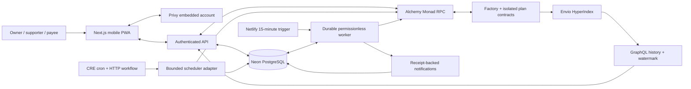

<p align="center">
  
</p>

<h1 align="center">Fallback</h1>
<p align="center"><strong>A backup for the payments that matter.</strong></p>
<p align="center">Family-backed recurring payments. Your allocated money pays first.<br />Backup covers the agreed shortfall. Unused support is yours to reclaim.</p>

<p align="center">
  <a href="https://fallbackk.netlify.app">Try the live app</a> ·
  <a href="https://fallbackk.netlify.app/about">How it works</a> ·
  <a href="https://github.com/vkk28/fallback">Public repository</a> ·
  <a href="docs/test-report.md">Verification evidence</a>
</p>

<p align="center"><strong>Metropolis · Consumer Products &amp; Payments</strong><br />Privy · Envio · Alchemy · Chainlink CRE</p>

> **Live on Monad Testnet (10143).** Amounts use FBTEST, a six-decimal test token with no real value. The app, API, database, indexer and scheduled worker run independently of the developer's laptop.

[Product](#how-fallback-works) · [Judge walkthrough](#a-judges-walkthrough) · [Sponsor integrations](#sponsor-integrations) · [Architecture](#architecture-and-authority) · [Verification](#what-has-been-verified) · [Run locally](#run-it-locally)

## The problem we are building for

A freelancer's housing payment has a fixed date. Their client payment may not. A family member is willing to help, but wants to agree how much, for how long, and what happens to money that is never needed.

Fallback turns that promise into a **funded, capped payment reserve**. The recipient allocates their own money, family reserves backup, and a consenting payee accepts the exact schedule. Each payment uses the recipient's allocation first. Backup contributes only the remaining gap, within the agreed limits. When the plan ends, each person can independently claim their remaining money.

Our initial segment is **early-career freelancers with irregular income timing, receiving temporary family support for housing payments to a known person who accepts the supported asset**. This is the product hypothesis guiding the build; it is not a claim of completed customer research.

## See the product

<table>
  <tr>
    <th>Understand the arrangement</th>
    <th>See the next payment</th>
    <th>Check what actually happened</th>
  </tr>
  <tr>
    <td align="center"></td>
    <td align="center"></td>
    <td align="center"></td>
  </tr>
</table>

Captured from the live app in Chrome's **iPhone 17 Pro Max Mobile View preset (440 × 956)**. These are browser previews, not physical-device tests. Future payment splits are forecasts.

## How Fallback works

1. **Agree before money moves.** The owner creates a schedule and invites the payee. The payee accepts the precise onchain terms before publication. Joining an invitation is separate from financial consent.
2. **Fund a specific plan.** Owner allocations and supporter reserves have separate accounting inside a dedicated contract. Exact token permission and the actual deposit are separate steps.
3. **Start with clear limits.** Activation requires the minimum reserve, locks active funds and freezes supporter weights. The owner can add their own money; supporters cannot change an active commitment.
4. **Make a complete payment.** At execution, allocated owner money pays first, followed by permitted backup. The whole installment goes to the immutable payee in one transfer. Insufficient funds or a restrictive cap transfer nothing.
5. **End and reclaim independently.** Completion, funding expiry or owner cancellation closes the plan. Ending cancels unpaid installments. Remaining owner money and unused support become separately claimable by recorded beneficiaries.

The condition is a **shortfall in money allocated to this plan**. External wallet balances, bank balances and income never determine eligibility.

### Follow the money

This acceptance case runs in the automated local-chain integration suite. It illustrates the contract rules; it is not three claimed hosted payments.

The owner allocates **250 FBTEST**. Supporters A and B reserve **200** and **100 FBTEST**. Three payments are **150 FBTEST** each, with a 150 per-payment backup cap and 100% permitted coverage.

| Installment | Owner money used | Backup used | Complete payment |
| --- | ---: | ---: | ---: |
| 1 | 150 | 0 | 150 |
| 2 | 100 | 50 | 150 |
| 3 | 0 | 150 | 150 |
| **Total** | **250** | **200** | **450** |

The unused **100 FBTEST** yields independent returns of **66.666666** and **33.333334 FBTEST** under frozen contribution ordering. Every base unit is assigned; claim order does not change entitlements.

A top-up can unblock a payment **inside its window**. At `block.timestamp >= due + grace`, the installment can only become missed. Later installments cannot bypass an unresolved earlier one. A missed installment creates no debt and consumes no funds.

## A judge's walkthrough

Start with the public [About page](https://fallbackk.netlify.app/about), then open [Home](https://fallbackk.netlify.app/dashboard) and sign in with your own email. Privy creates the embedded account. No browser wallet extension, shared password or native gas purchase is required for the configured sponsored user actions.

A fresh account starts with its own empty workspace. Testers' existing private plans are not public demo records. Use three distinct email accounts to explore the full journey:

| Role | Action | What to observe |
| --- | --- | --- |
| Owner | Create a plan through the four-step setup; invite the payee; propose terms | Saved setup, schedule/timezone, caps and readable terms |
| Payee | Sign in, open the bound Home request, join and accept the proposed terms | Membership and onchain acceptance are distinct |
| Owner | Publish the accepted plan and invite a supporter | The destination and payment terms become immutable |
| Supporter | Join, review terms, use **Need test tokens?**, authorize an exact amount, then deposit | Permission alone leaves the reserve unchanged; deposit increases it |
| Owner | Allocate test money if desired; activate before the funding deadline | Minimum reserve is checked and supporter weights freeze |
| All roles | Explore **Overview, Schedule, Activity and Terms** | Current funds, future forecasts, paid/missed outcomes and indexed events |
| Owner / supporter | Review ending the plan, then separately claim any return | Cancellation consequences, individual claim amounts and confirmation |

Choose a future first payment and an earlier funding deadline. Each account authorizes its own actions. The hosted worker checks every **15 minutes**; execution depends on the actual block timestamp, window, funds and caps. A submitted request or queued job is not a completed payment.

For evaluation without waiting for a schedule, `pnpm test:local-chain` and `pnpm test:cre-batch` exercise disposable local chains without changing hosted plans.

## Why Consumer Products & Payments

The [primary track](https://hackathon.monad.xyz/tracks/consumer-payments) asks for consumer finance whose design benefits from onchain execution. Fallback makes **conditional, bounded support** the central interaction: a reserve stays committed to a payment plan, is consumed only under its agreed rules, and remains attributable to contributors when unused.

| Judging criterion | Fallback's response |
| --- | --- |
| **Technical execution · 20%** | Deployed contracts enforce consent, complete payments, own-money-first splits, caps, chronological processing, exact windows and independent returns. |
| **Design & craft · 20%** | Email onboarding, embedded accounts, sponsored actions, progressive setup, mobile navigation and distinct pending/confirmed/indexed states. |
| **Originality & track insight · 15%** | Family support becomes a temporary payment-specific commitment with programmable limits and attributable unused funds. |
| **Founder & market readiness · 25%** | A focused segment: freelancers, family supporters and consenting housing payees facing payment-timing gaps. |
| **Traction & path forward · 20%** | Verified technical and role journeys establish a baseline for a consented consumer pilot; no adoption figures are asserted. |

**Proposed path to 100 users:** begin with five freelancer–family–payee groups. Measure unaided setup, understanding of limits, successful funding and reclaiming unused money. Recruit through freelancer communities and personal referrals, then expand through the existing payee/supporter invitation flow. This is a proposed distribution plan, not reported traction.

## Sponsor integrations

These are the project's intended bounty entries. Official requirements were inspected in the signed-in Metropolis portal on **13 October 2026**. Detailed proof scope is in [integration evidence](docs/integrations.md).

### Privy — the account layer behind the payment journey

The [Privy bounty](https://hackathon.monad.xyz/tracks/privy) requires functionality beyond login. Fallback uses canonical embedded Ethereum accounts for user-authorized, sponsored actions: proposing/accepting terms, publication, funding, activation, top-ups, ending and claims.

The browser authorizes the exact stored request. The backend verifies account/role access, network, destination, selector and amount. Durable identities and receipt reconciliation preserve the same action across reloads. Earlier provider evidence reconciles **38 confirmed actions across 13 action types**; newer onboarding actions have separate onchain evidence outside that provider capture.

**Source:** [account provider](apps/web/app/ui/privy-gate.tsx) · [client authorization](apps/web/app/ui/transaction.ts) · [canonical identity](packages/backend/src/auth.ts) · [sponsored calls](packages/backend/src/transactions.ts) · [receipts](packages/backend/src/receipts.ts).

### Envio — history that explains where the money went

The [Envio bounty](https://hackathon.monad.xyz/tracks/best-use-of-envio) requires a working pipeline powering a useful feature. Fallback's deployed HyperIndex pipeline dynamically registers factory-created plans and reconstructs funding, frozen shares, own/backup payment splits, missed/cancelled installments, closures and claims.

The app consumes derived entities through bounded GraphQL queries for plan Activity and financial history. Integer amounts and chain/transaction/log identities preserve exact accounting and prevent duplicates. A processing watermark reports coverage separately from current-state RPC reads. Hosted reconciliation covers **four plans and 27 canonical plan events** with matching historical accounting.

**Required artifacts:** [cloud config.yaml](config.yaml) · [schema.graphql](indexer/schema.graphql) · [event handlers](indexer/src/handlers/events.ts) · [app GraphQL reader](packages/backend/src/indexer.ts) · [plan interface](apps/web/app/ui/plan.tsx).

### Alchemy — authoritative Monad reads and execution

The [Alchemy bounty](https://hackathon.monad.xyz/tracks/best-projects-using-alchemy) requires meaningful use of a supported service in a functional Monad project. Fallback uses private **Alchemy Monad Testnet RPC** for contract reads, same-block snapshots, receipt reconciliation and the worker's fixed permissionless calls.

Verified Multicall3 reduces a plan snapshot to six RPC requests and Home summaries to four. Read failures leave amounts unknown and disable dependent money actions. Runtime readiness, compiled token/factory runtime and immutable settings were checked through the configured endpoint. Credentials stay server-side.

**Source:** [chain client and snapshots](packages/chain/src/client.ts) · [worker gateway](apps/worker/src/gateway.ts) · [deployment checks](scripts/verify-network.mjs).

### Chainlink CRE — orchestration across HTTP, SQL and Monad

The [CRE bounty](https://hackathon.monad.xyz/tracks/best-workflow-with-cre) requires meaningful blockchain/external-system orchestration and successful CLI simulation or CRE-network deployment. Fallback's cron workflow obtains a bounded frozen discovery page from the hosted HTTPS adapter, validates it and submits the exact batch in **two HTTP calls**.

The adapter rechecks Monad state and atomically enqueues durable jobs with cursor advancement. The worker journals each signed call before broadcast, reconciles canonical receipts and creates idempotent in-app notifications. Repeated batches preserve acknowledgements without duplicate work. This is an explicit **HTTP/RPC adapter**, rather than a native CRE Monad write.

**Evidence scope:** actual hosted CRE CLI simulation succeeds with four plans scanned and zero eligible jobs accepted. Separate local batch-to-payment verification executes **150 FBTEST (100 own / 50 backup)** through three SQL restarts with one job, signature and broadcast. Useful hosted CRE enqueue/payment and CRE-network deployment are not established by those results. The verified hosted payment below was executed by the independent worker.

**Source:** [cron workflow](workflows/cre/main.ts) · [HTTP handler](workflows/cre/handler.ts) · [batch coordinator](apps/worker/src/discovery.ts) · [durable jobs](apps/worker/src/jobs.ts) · [simulation helper](scripts/cre-simulate.ts).

## Architecture and authority



**Contracts hold plan funds and enforce the money rules.** Privy powers user authorization. PostgreSQL stores private labels, invitations, requests and jobs. Envio explains history. The worker provides liveness using fixed settlement/expiry/closure calls; it cannot choose another payee or change the payment split.

There is no proxy upgrade, administrator sweep or discretionary payment approval. Onchain amounts and timing are public; personal labels and emails stay offchain. The PWA caches safe static assets, disables financial actions offline and never queues money actions for automatic replay.

**Stack:** Next.js / React / TypeScript · Solidity 0.8.30 / OpenZeppelin / Foundry · viem · Privy · Envio HyperIndex / GraphQL · Chainlink CRE · PostgreSQL / Drizzle · Netlify / Neon · Vitest / Playwright / axe-core.

[Architecture and trust boundaries](docs/architecture.md) · [State machine and accounting](docs/state-machine.md) · [Security](docs/security.md) · [Operations](docs/operations.md).

## Deployed contracts

| Contract | Monad Testnet address |
| --- | --- |
| FallbackFactory | [`0x658eE9465274e74C179719A7cbb6402201c36023`](https://testnet.monadexplorer.com/address/0x658eE9465274e74C179719A7cbb6402201c36023) |
| FallbackTestToken · FBTEST | [`0xb6cD9F9dCC2Ef475498d1D0D6E236Cf79D33008B`](https://testnet.monadexplorer.com/address/0xb6cD9F9dCC2Ef475498d1D0D6E236Cf79D33008B) |

Each published plan has its own immutable contract registered by the factory. The [deployment manifest](packages/chain/deployments/monad-testnet.json) includes actual token/factory deployment receipts. Compiled runtime and immutable settings are verified; explorer source publication has a separate status in that manifest.

## What has been verified

Dated results through **13 October 2026** distinguish local tests, hosted outcomes and simulations. The [actual test report](docs/test-report.md) records commands, dates and limitations.

| Evidence | Result and scope |
| --- | --- |
| Application and contract suites | **132 application tests + 49 contract checks**, including consent replay, caps, boundaries, conservation, adversarial tokens and cross-plan isolation |
| Local-chain lifecycle | Complete payment splits, exact refunds, in-window top-up recovery, late-expiry refusal and competing workers |
| Hosted scheduled payment | **150 FBTEST paid on 12 October at 04:00:42 IST: 150 own / 0 backup**; complete immutable-payee transfer inside its window, reconciled to the canonical receipt |
| Hosted cancellation and returns | Separate owner/supporter returns reconciled; both completed cancellation cases have zero remaining claims |
| Hosted indexing | Four plans / 27 canonical plan events with exact historical accounting |
| Accounts and sponsorship | Real role actions; 38 earlier provider actions reconciled; exact approval/deposit separation and reload recovery |
| Worker / CRE-batch recovery | Real local payment through three SQL restarts; one signature/broadcast; replay produces no duplicate payment or notification |
| Browser and UI | 13 isolated browser checks, public accessibility/layout coverage and authenticated narrow-screen Chrome inspection |
| Build and security | Types, lint, production build, secret scans and chain/runtime checks; automated static analysis with no high/medium findings |

These checks do not establish an independent audit, physical-device accessibility certification or production financial readiness. Broader live failure/device campaigns are documented in [remaining verification](docs/remaining-verification.md).

## Run it locally

Use **Node 24.19.0** and **pnpm 11.25.0**, with Node 24 selected on your PATH.

```sh
pnpm install --frozen-lockfile
node scripts/prepare-env.mjs
pnpm compiler:install
```

The environment helper preserves existing values and creates an ignored `.env` with private permissions. Configure your own providers using [.env.example](.env.example) and [provider setup](docs/provider-setup.md). Creating `.env` alone does not connect Privy, the database, deployment/RPC or indexer. Keep secrets out of tracked files and `NEXT_PUBLIC_*` variables.

```sh
pnpm services:start database
pnpm db:migrate
pnpm web:dev
```

Open `http://localhost:3000`. `/about` explains the product; `/dashboard` shows role plans/requests; `/new` opens setup; `/invite` previews bound invitations. The local database uses loopback port 54329. For persistent built services: `pnpm web:build`, then `pnpm services:start web`. Inspect/stop owned services with `pnpm services:status` / `pnpm services:stop`.

### Reproduce the checks

```sh
pnpm check
pnpm test:local-chain
pnpm test:postgres
pnpm test:worker-chain
pnpm test:cre-batch
pnpm lint:app
pnpm web:typecheck
pnpm indexer:configure
pnpm indexer:codegen
pnpm indexer:typecheck
pnpm indexer:verify
pnpm cre:typecheck
pnpm cre:test
pnpm cre:build
pnpm web:build
pnpm test:browser
pnpm scan:source
pnpm scan:client-secrets
pnpm chain:verify
```

Browser checks require matching Playwright Chromium in `.tools/browsers`; CRE SDK checks/builds require Bun. Local-chain harnesses clean up isolated Anvil instances. Provider checks require their documented configuration. The compiler installer verifies the official checksum; Apple Silicon needs Rosetta for the selected macOS compiler. Docker is optional for local Hasura development and is not required by the hosted app.

Actual hosted-adapter CRE commands:

```sh
pnpm cre:simulate --authorized-origin https://fallbackk.netlify.app
pnpm cre:execute --authorized-origin https://fallbackk.netlify.app
```

CRE authentication and the private relay credential are required. `cre:execute` exits **2** for a verified empty/stale scan; exit **0** requires accepted work and still needs payment-receipt reconciliation. Eligible runs can enqueue actual permissionless testnet jobs. CRE-network deployment uses a separate procedure.

## Submission materials

The [track deliverables](https://hackathon.monad.xyz/tracks/consumer-payments) and sponsor fields map to these artifacts. Submission recordings and final portal selections are maintained separately from this repository.

| Material | Artifact / requirement |
| --- | --- |
| Live product and judge access | [fallbackk.netlify.app](https://fallbackk.netlify.app), with the walkthrough above |
| Public source | [github.com/vkk28/fallback](https://github.com/vkk28/fallback) |
| Project graphic | [512px PNG logo](apps/web/public/icons/512.png), within the portal's 3 MB limit |
| Main technical demo | Required portal recording, **up to 3 minutes**, showing the working live product |
| Pitch | Required portal recording, **up to 2 minutes**, introducing the team, problem and motivation |
| Privy / Envio / Alchemy descriptions | Sponsor sections above; optional **up to 2-minute** integration demos |
| CRE description and demo | CRE section above; required **up to 2-minute** video of actual CLI simulation or CRE-network deployment |

## Product boundaries and path forward

Fallback supports voluntary, funded test-token payments to a consenting person. It does not deliver fiat to a bank, verify external bills or determine financial hardship. Backup is limited and cannot guarantee every payment. Active funds are locked until closure; unused support requires a separate claim. A recipient may have money elsewhere, and a known payee may still collude. Keeping labels private does not hide public onchain activity.

Next product steps are the proposed consumer pilot, actual-device installation/accessibility verification and broader hosted failure campaigns. Real assets or bank settlement require separately scoped integration and review. Free hosting quotas and Envio Development's temporary lifetime constrain demo availability.

For maintainers: [progress](progress.md) · [handoff](docs/HANDOFF.md) · [decisions](docs/decisions.md) · [integration evidence](docs/integrations.md) · [technical bounty notes](docs/bounty-engineering-notes.md) · [tooling](docs/tooling.md).
