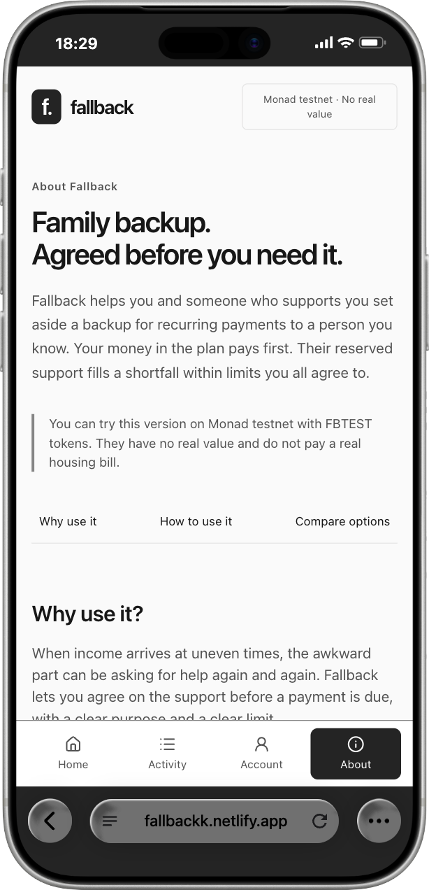
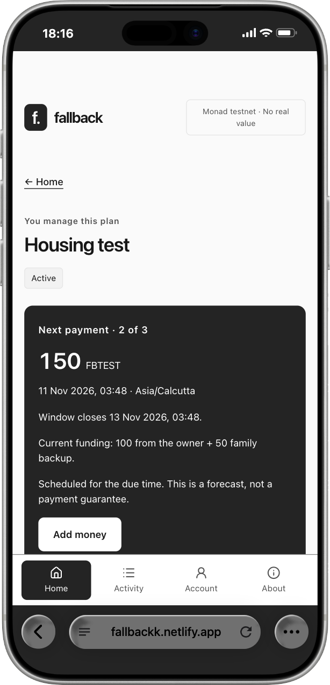
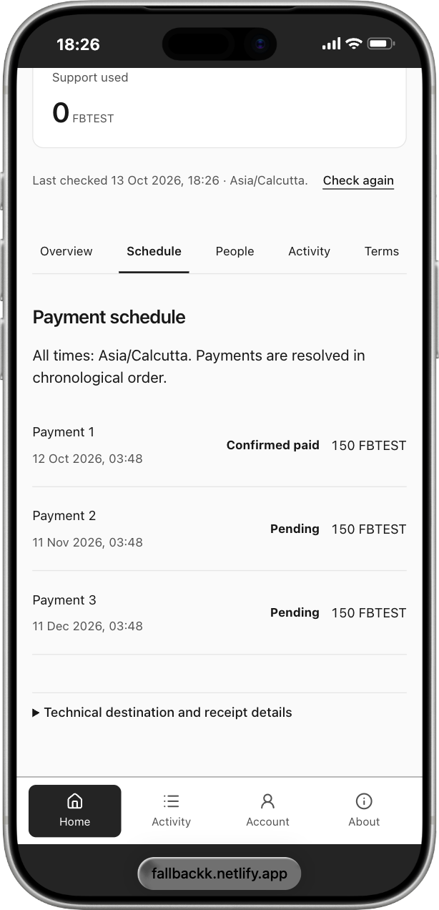

  

<h1 align="center">Fallback</h1>

<strong>A backup for the payments that matter.</strong>

Family-backed recurring payments. Your allocated money pays first. Backup covers the agreed shortfall. Unused support is yours to reclaim.

  <a href="https://fallbackk.netlify.app">Open Fallback</a> ·
  <a href="https://fallbackk.netlify.app/about">How it works</a> ·
  <a href="#run-it-locally">Run locally</a>

<strong>Built on Monad</strong> Privy · Envio · Alchemy · Chainlink CRE

> **Deployed on Monad Testnet (10143).** Amounts use FBTEST, a six-decimal test token with no real value.

[Product](#how-fallback-works) · [Walkthrough](#try-fallback) · [Integrations](#integrations) · [Architecture](#architecture) · [Contracts](#deployed-contracts) · [Development](#run-it-locally)

## A little certainty when income is unpredictable

A freelancer's housing payment has a fixed date. Their client payment may not. A family member is willing to help, but wants to agree how much, for how long, and what happens to money that is never needed.

Fallback turns that promise into a **funded, capped payment reserve**. The owner allocates their own money, family reserves backup, and a consenting payee accepts the schedule. Each payment uses the owner's allocation first. Backup contributes only the remaining gap, within the agreed limits. When the plan ends, each person can independently reclaim their remaining money.

## See the product

<table>
  <tr>
    <th>Understand the arrangement</th>
    <th>See the next payment</th>
    <th>Follow the schedule</th>
  </tr>
  <tr>
    <td align="center"></td>
    <td align="center"></td>
    <td align="center"></td>
  </tr>
</table>

Captured from the deployed app using Chrome's iPhone 17 Pro Max browser preset. Future payment splits are labelled forecasts.

## How Fallback works

1. **Agree before money moves.** Create a schedule and invite the payee. The payee accepts the exact onchain terms before publication. Joining an invitation and accepting financial terms are separate actions.
2. **Fund a specific plan.** Allocate your own money and invite supporters to reserve backup. Each plan has a dedicated contract with separate accounting. An exact token permission precedes the actual deposit.
3. **Start with clear limits.** Activation requires the minimum reserve, locks active funds and freezes supporter weights. The owner can continue adding their own money; supporters cannot change an active commitment.
4. **Make a complete payment.** Allocated owner money pays first, followed by permitted backup. The whole installment goes to the agreed payee in one transfer. If funds or caps prevent a complete payment, nothing moves.
5. **End and reclaim independently.** Completion, funding expiry or owner cancellation closes the plan. Ending cancels unpaid installments. Remaining owner money and unused support become separately claimable by their recorded beneficiaries.

Support depends on the **money allocated to this plan**. External wallet balances, bank balances and income never determine eligibility.

### Follow the money

In this example, covered by the local-chain integration suite, the owner allocates **250 FBTEST**. Two supporters reserve **200** and **100 FBTEST**. Three payments are **150 FBTEST** each, with a 150 per-payment backup cap and 100% permitted coverage.

| Installment | Owner money used | Backup used | Complete payment |
| --- | ---: | ---: | ---: |
| 1 | 150 | 0 | 150 |
| 2 | 100 | 50 | 150 |
| 3 | 0 | 150 | 150 |
| **Total** | **250** | **200** | **450** |

The unused **100 FBTEST** yields independent returns of **66.666666** and **33.333334 FBTEST** under frozen contribution ordering. Every base unit is assigned; claim order does not change entitlements.

A top-up can unblock a payment inside its window. At <code>block.timestamp >= due + grace</code>, the installment can only become missed. Later installments cannot bypass an unresolved earlier one. A missed installment creates no debt and consumes no funds.

## Try Fallback

Start with the public [About page](https://fallbackk.netlify.app/about), then open [Home](https://fallbackk.netlify.app/dashboard) and sign in with your email. Privy creates the embedded account, and configured user actions are sponsored. A browser wallet extension is not required.

Each account starts with its own private workspace. Use three distinct accounts to explore the complete journey:

| Role | Action |
| --- | --- |
| Owner | Create a plan through the four-step setup, invite the payee and propose terms. |
| Payee | Join the bound Home request and accept the proposed payment terms. |
| Owner | Publish the accepted plan and invite a supporter. |
| Supporter | Join, review terms, use **Need test tokens?**, authorize an exact amount and deposit. |
| Owner | Allocate test money and activate before the funding deadline once the minimum backup is reserved. |
| Everyone | Explore **Overview, Schedule, People, Activity and Terms** for current funds, forecasts and confirmed outcomes. |
| Owner / supporter | After completion or cancellation, claim your own unused money independently. |

Choose a future first payment and an earlier funding deadline. Each account authorizes its own actions. The hosted worker checks every **15 minutes**; execution depends on the actual block timestamp, window, funds and caps. Confirmed receipts establish completed payments.

## Integrations

| Integration | Role in Fallback | Source |
| --- | --- | --- |
| **Privy** | Email sign-in, canonical embedded Ethereum accounts and user-authorized sponsored actions throughout the payment journey. Durable requests and receipt reconciliation support reload and retry recovery. | [Account provider](apps/web/app/ui/privy-gate.tsx) · [Authorization](apps/web/app/ui/transaction.ts) · [Sponsored calls](packages/backend/src/transactions.ts) |
| **Envio** | HyperIndex dynamically registers plans and reconstructs funding, frozen shares, payment splits, closures and claims. Bounded GraphQL history powers Activity; a processing watermark tracks coverage. | [Cloud config](config.yaml) · [Schema](indexer/schema.graphql) · [Handlers](indexer/src/handlers/events.ts) · [Reader](packages/backend/src/indexer.ts) |
| **Alchemy** | Private Monad Testnet RPC for same-block snapshots, receipt reconciliation and fixed permissionless worker calls. Verified Multicall3 batches reads; failures leave amounts unavailable. | [Chain client](packages/chain/src/client.ts) · [Worker gateway](apps/worker/src/gateway.ts) · [Network verification](scripts/verify-network.mjs) |
| **Chainlink CRE** | A cron workflow validates a bounded discovery page and submits the batch through an authenticated HTTP/RPC adapter. The adapter rechecks Monad state and atomically enqueues durable jobs. | [Workflow](workflows/cre/main.ts) · [HTTP handler](workflows/cre/handler.ts) · [Coordinator](apps/worker/src/discovery.ts) · [Jobs](apps/worker/src/jobs.ts) |

CRE validation covers hosted CLI discovery simulation and a separate local batch-recovery test of a **150 FBTEST payment (100 own / 50 backup)** through three SQL restarts. The independent hosted worker supplies routine scheduled execution. See the [architecture reference](docs/architecture.md) for the workflow's execution and deployment scope.

## Architecture

~~~mermaid
flowchart LR
    User[Owner / supporter / payee] --> App[Next.js mobile PWA]
    App <--> Privy[Privy embedded account]
    App <--> API[Authenticated API]
    API <--> DB[(Neon PostgreSQL)]
    API <--> RPC[Alchemy Monad RPC]
    RPC <--> Contracts[Factory + isolated plan contracts]
    Contracts --> Envio[Envio HyperIndex]
    Envio --> History[GraphQL history + watermark]
    History --> API
    CRE[CRE cron + HTTP workflow] --> Adapter[Scheduler adapter]
    Adapter --> RPC
    Adapter --> DB
    Tick[Netlify 15-minute trigger] --> Worker[Permissionless worker]
    DB <--> Worker
    Worker --> RPC
    Worker --> Notifications[Receipt-backed notifications]
    Notifications --> DB
~~~

**Contracts hold plan funds and enforce the money rules.** Privy powers user authorization. PostgreSQL stores private labels, invitations, requests and jobs. Envio explains history. The worker executes fixed settlement, expiry and closure calls; it cannot choose another payee or change a payment split.

There is no proxy upgrade or administrator sweep. Personal labels and emails stay offchain; onchain amounts and timing are public. The PWA caches safe static assets, disables financial actions offline and never queues money actions for automatic replay. The hosted app, database, indexer and worker operate independently of a local development machine.

**Stack:** Next.js / React / TypeScript · Solidity 0.8.30 / OpenZeppelin / Foundry · viem · Privy · Envio HyperIndex / GraphQL · Chainlink CRE · PostgreSQL / Drizzle · Netlify / Neon · Vitest / Playwright / axe-core.

[Architecture and trust boundaries](docs/architecture.md) · [State machine and accounting](docs/state-machine.md) · [Security](docs/security.md) · [Deployment](docs/deployment.md)

## Deployed contracts

| Contract | Monad Testnet address |
| --- | --- |
| FallbackFactory | [0x658eE9465274e74C179719A7cbb6402201c36023](https://testnet.monadexplorer.com/address/0x658eE9465274e74C179719A7cbb6402201c36023) |
| FallbackTestToken · FBTEST | [0xb6cD9F9dCC2Ef475498d1D0D6E236Cf79D33008B](https://testnet.monadexplorer.com/address/0xb6cD9F9dCC2Ef475498d1D0D6E236Cf79D33008B) |

Each published plan has its own immutable contract registered by the factory. The [deployment manifest](packages/chain/deployments/monad-testnet.json) records token/factory addresses and actual deployment receipts. <code>pnpm chain:verify</code> checks the configured network, compiled runtime and immutable settings.

## Run it locally

Use **Node 24.19.0** and **pnpm 11.25.0**, with Node 24 selected on your PATH.

~~~sh
pnpm install --frozen-lockfile
node scripts/prepare-env.mjs
pnpm compiler:install
~~~

The environment helper preserves existing values and creates an ignored .env with private permissions. Configure your own providers using [.env.example](.env.example) and [provider setup](docs/provider-setup.md).

~~~sh
pnpm services:start database
pnpm db:migrate
pnpm web:dev
~~~

Open [localhost:3000](http://localhost:3000). The /about route explains the product; /dashboard shows role plans and requests; /new opens setup; /invite previews bound invitations. The local database uses loopback port 54329. Inspect or stop owned services with <code>pnpm services:status</code> / <code>pnpm services:stop</code>.

### Verification

The suites cover consent replay, payment caps, exact time boundaries, conservation, adversarial tokens, independent returns, cross-plan isolation and worker recovery. Local-chain harnesses use disposable chains and do not change hosted plans.

~~~sh
pnpm check
pnpm test:local-chain
pnpm test:postgres
pnpm test:worker-chain
pnpm test:cre-batch
pnpm lint:app
pnpm web:typecheck
pnpm indexer:configure
pnpm indexer:codegen
pnpm indexer:typecheck
pnpm indexer:verify
pnpm cre:typecheck
pnpm cre:test
pnpm cre:build
pnpm web:build
pnpm test:browser
pnpm scan:source
pnpm scan:client-secrets
pnpm chain:verify
~~~

Browser checks require matching Playwright Chromium in .tools/browsers; CRE SDK checks and builds require Bun. Provider checks require their documented configuration. The compiler installer verifies the official checksum; Apple Silicon needs Rosetta for the selected macOS compiler. Docker is optional for local Hasura development.

Fallback supports voluntary, funded test-token payments to a consenting person. Backup is capped and cannot guarantee every installment. Active funds stay committed until closure, and unused money requires a separate claim. Bank payments and external bill verification are outside the supported payment model. See the [security model](docs/security.md) for trust boundaries.
