# Contract state and accounting

```mermaid
stateDiagram-v2
    [*] --> Draft
    Draft --> Accepted: bound payee accepts exact terms onchain
    Accepted --> Open: recipient publishes once before consent expiry
    Open --> Active: recipient activates before funding deadline; reserve minimum met
    Open --> Closed: recipient cancels / anyone closes expired funding
    Active --> Closed: recipient cancels / final installment becomes terminal
    Closed --> Closed: independent beneficiary claims
```

Draft/Accepted live in the factory; Open/Active/Closed live in each immutable plan.
Acceptance is an onchain account transaction, not an EIP-712 signature. It works
with contract accounts through their own authorization logic; there is no offchain
signature replay surface. Nonces and domain-bound hashes separate plans/chains/factories.

| Operation | Authority and boundary |
| --- | --- |
| add own money | Recipient; Open before deadline or Active; positive amount |
| withdraw own money | Recipient; Open only |
| contribute/withdraw support | Contributing supporter; Open; deposits before deadline and within total reserve/slot caps |
| activate | Recipient; strictly before deadline, minimum reserve met; freezes positive weights/order |
| settle next | Anyone; Active; only next chronological Pending installment; `due <= timestamp < due + grace` |
| expire next | Anyone; Active; `timestamp >= due + grace`; changes to Missed without moving funds |
| cancel | Recipient; Open or Active; remaining installments Cancelled, balances become refundable |
| close abandoned funding | Anyone; Open; at/after funding deadline |
| claim for beneficiary | Anyone; Closed; money only to recorded beneficiary, never caller-selected destination |

For installment D: `own=min(allocated,D)`, `gap=D-own`, percentage cap is
`floor(D*coverBps/10000)`, and allowed backup is the minimum of that cap,
per-payment cap, and attributed reserve. Transfer exactly D only if the gap fits.
Failed attempts revert atomically and remain Pending. Zero-gap payments work with
zero reserve. Eligibility is evaluated at execution, including top-ups within grace;
it is not a historical balance snapshot. Block timestamps govern all boundaries.

After every terminal installment the cursor advances once. No arbitrary installment
selection or early settlement exists. Up to twelve expiry calls catch up after an
outage. Final processing automatically closes, including all-missed schedules.
Cancellation cannot undo an already paid installment; chain ordering resolves races.

At closure, recipient allocation moves to its separate refund liability. Remaining
reserve R is frozen. With frozen total F and ordered contribution f after prefix P,
entitlement is `floor(R*(P+f)/F)-floor(R*P/F)`, calculated with OpenZeppelin mulDiv.
The differences telescope to R exactly, independently of claim order. Activation
requires F>0; an unactivated plan uses each attributed contribution directly.
Claims are independent, mark state before transfer, and revert wholly if the token
transfer fails. Failed claims do not prevent closure or another person's refund.

`totalDeposited = totalPaid + totalWithdrawn + totalClaimed + liabilities`.
Liabilities sum live own allocation, live reserve, and outstanding own/support
refunds. Actual holdings must cover these liabilities. Deposit and send balance
deltas reject fee behavior, but the immutable configured asset must still be a
reviewed conventional non-rebasing token. External wallet balances and approvals
do not affect deposited funding or settlement. Unsolicited tokens remain unaccounted,
do not change weights/eligibility, and cannot be swept by an administrator.
